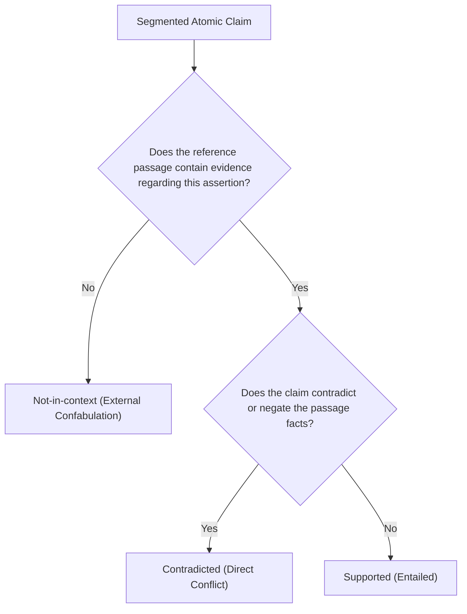

# NepFaith-120: Annotation Rubric v1

> **Status:** Frozen for Gate 0 (Sprint 0)  
> **Author:** Human Lead (Muskan Bhandari) & AI Assistant  
> **Target:** Claim-Level Faithfulness Scoring in Nepali → English RAG  

---

## 1. Objective and Architecture

This rubric defines the operational protocol for annotating factual faithfulness of English answers generated from Nepali reference contexts. Faithfulness is framed strictly as **grounded entailment** against the provided context passage, *not* real-world truth or answer completeness.

Annotation proceeds in two sequential stages:
1. **Atomic Claim Segmentation:** Decomposing multi-sentence English answers into standalone, checkable factual propositions.
2. **Three-Way Grounded Entailment Verification:** Scoring each atomic claim against the reference context under conditions $C1$ (Nepali), $C2$ (IndicTrans2 English), and $C3$ (Post-Edited English).

---

## 2. Atomic Claim Segmentation Rules

An answer $A$ is segmented into a set of atomic claims $\{k_1, k_2, \dots, k_m\}$. A valid atomic claim must satisfy four fundamental criteria:

| Property | Rule | Good Example | Bad Example (Violation) |
|---|---|---|---|
| **Single Proposition** | Asserts exactly one factual relation that can be evaluated as a single truth unit. | *"Sagarmatha is 8,848.86 meters tall."* | *"Sagarmatha is 8,848.86 meters tall and lies on the Nepal-China border."* (Two propositions) |
| **Self-Contained** | All pronouns, relative clauses, and indexicals are resolved so the claim is understandable in isolation. | *"Pushpa Kamal Dahal visited New Delhi in June 2023."* | *"He visited the city in June."* (Unresolved pronouns) |
| **Truth Fidelity** | Preserves the exact meaning, modality, and tense of the generated answer without correcting or editorializing errors. | If answer says *"Nepal won 50 gold medals"*, claim must state *"Nepal won 50 gold medals"*. | Rewriting to *"Nepal won 51 medals"* because the annotator knows the true figure. |
| **Checkable Assertion** | Evaluates factual assertions only; discourse markers, conversational filler, and subjective hedges are dropped. | *"The hydropower project produces 456 MW."* | *"In my opinion, the hydropower project is very impressive."* |

---

## 3. Three-Way Grounded Label Definitions

Each segmented claim $k_j$ is evaluated against the reference passage $P$ and assigned exactly one of three mutually exclusive labels:

### Label 1: `Supported`
- **Definition:** The proposition is directly entailed by the reference passage. A reasonable reader, relying only on the passage, would conclude the claim is true.
- **Includes:** Direct assertions, exact figures, and strict logical deductions/paraphrases.

### Label 2: `Contradicted`
- **Definition:** The claim directly conflicts with, refutes, or negates facts explicitly asserted in the reference passage.
- **Includes:** Entity swaps, flipped numbers/dates, reversed polarities (negation), and inverted causal chains.
- **Distinction:** Requires *active contradictory evidence* in the reference text.

### Label 3: `Not-in-context`
- **Definition:** The claim introduces assertions that are neither affirmed nor contradicted by the reference passage.
- **Includes:** Plausible real-world facts from parametric memory, ungrounded elaborations, and hallucinations that do not directly clash with the context.
- **Distinction:** $\text{Contradicted} \ne \text{Not-in-context}$. Confabulations that add external facts must never be conflated with assertions that actively conflict with the context.

---

## 4. Critical Claim Override & Derived Item Faithfulness

To evaluate the overall generated answer item, claim-level judgments are aggregated:

1. **Claim Criticality Classification:**
   - **`critical`:** Core assertions that directly answer the user query or represent primary factual predicates.
   - **`non_critical`:** Peripheral background context, minor descriptive clauses, or transitional claims.

2. **Derived Item Faithfulness ($Y_{\text{item}}$):**
   - An item is marked **`Faithful`** ($1$) if and only if **100% of constituent claims** are labeled `Supported`.
   - **Critical Claim Override Rule:** If any claim flagged as `critical` receives a label of `Contradicted` or `Not-in-context`, the entire item is immediately designated **`Unfaithful`** ($0$), regardless of the proportion of supported non-critical claims.

---

## 5. The 7 Typed Perturbations (Negative Taxonomy)

To prevent evaluator skew and ensure robust sensitivity testing, 50% of benchmark items are synthesized using deterministic perturbations across 7 categories:

### 1. Entity Swap (`entity_swap`)
- **Mechanism:** Replace a key named entity (person, organization, district) with an in-domain distractor.
- **Target Label:** `Contradicted`
- **Nepali / English Example:**
  - *Context:* "चितवन राष्ट्रिय निकुञ्जमा एकसिङ्गे गैँडा संरक्षण गरिएको छ।"
  - *Perturbation:* Replacing *Chitwan National Park* with *Bardiya National Park*.

### 2. Number / Date Alteration (`number_date_alteration`)
- **Mechanism:** Modify numerical counts, percentages, currency, or calendar years (converting Bikram Sambat वि.सं. erroneously or shifting Gregorian dates).
- **Target Label:** `Contradicted`
- **Nepali / English Example:**
  - *Context:* "वि.सं. २०७२ को भूकम्पमा परि ८,९६४ जनाको मृत्यु भयो।"
  - *Perturbation:* Changing *8,964 deaths* to *9,864 deaths* or misinterpreting Bikram Sambat 2072 as Gregorian 2072 AD.

### 3. Negation Flip (`negation_flip`)
- **Mechanism:** Toggle grammatical polarity (inserting or deleting negation markers: गर्छ $\leftrightarrow$ गर्दैन, भयो $\leftrightarrow$ भएन).
- **Target Label:** `Contradicted`
- **Nepali / English Example:**
  - *Context:* "सरकारले रासायनिक मलमा दिँदै आएको अनुदान कटौती गरेन।"
  - *Perturbation:* "The government eliminated the subsidy on chemical fertilizers."

### 4. Attribution Removal / Misattribution (`misattribution`)
- **Mechanism:** Shifting reported statements, directives, or research findings to the wrong official body or speaker.
- **Target Label:** `Contradicted`
- **Nepali / English Example:**
  - *Context:* "नेपाल राष्ट्र बैंकले चालु आर्थिक वर्षको मौद्रिक नीति सार्वजनिक गर्‍यो।"
  - *Perturbation:* Attributing the Monetary Policy release to the *Ministry of Finance*.

### 5. Honorific / Register Shift (`register_shift`)
- **Mechanism:** Altering Nepali honorific hierarchy (तँ $\to$ तिमी $\to$ तपाईं $\to$ हजुर) causing grammatical pluralization or distortion of social authority.
- **Target Label:** `Contradicted` / `Not-in-context`
- **Nepali / English Example:**
  - *Context:* "प्रधानमन्त्रीज्यूले सम्बोधन गर्नुभयो।" (Singular high-honorific verb)
  - *Perturbation:* MT or LLM interprets honorific agreement as literal plural: *"The Prime Ministers addressed the assembly."*

### 6. Unsupported Addition (`unsupported_addition`)
- **Mechanism:** Injecting fluent, plausible external assertions not mentioned in the reference context.
- **Target Label:** `Not-in-context`
- **Nepali / English Example:**
  - *Context:* "पोखरा क्षेत्रीय अन्तर्राष्ट्रिय विमानस्थल सन् २०२३ जनवरी १ देखि सञ्चालनमा आएको हो।"
  - *Perturbation:* Adding: *"The airport was constructed with financial assistance from the Asian Development Bank."* (Absent from context).

### 7. Invented Causal Relation (`invented_causality`)
- **Mechanism:** Falsely connecting two independently true propositions with a causal link (*"because"*, *"consequently"*, *"leading to"*).
- **Target Label:** `Contradicted` / `Not-in-context`
- **Nepali / English Example:**
  - *Context:* "काठमाडौँमा भारी वर्षा भयो। यता सेयर बजारमा ५० अंकको गिरावट आयो।"
  - *Perturbation:* "The share market dropped by 50 points because of heavy rainfall in Kathmandu."

---

## 6. Pilot Annotation Protocol (8-Item Calibration)

Before bulk annotation of the 120-item gold set in Sprint 2, two annotators independently annotate the **8 Calibration Pilot Items**:
1. Measure exact wall-clock time from opening the item to saving the final claim verdict (recorded as **Minutes per Item** and **Minutes per Claim**).
2. Calculate initial agreement (Cohen's $\kappa$ / percent agreement).
3. Identify and document boundary ambiguities in the rubric.
