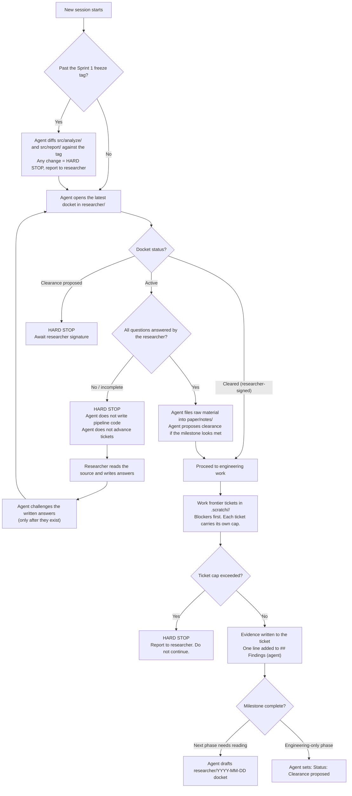

# NepFaith-120 — Research Workflow v2

## Flow



---

## Pillar 1 — Human / agent boundaries

| Responsibility | Researcher | Agent |
|---|---|---|
| Literature & reading | **Lead.** Reads primary sources, builds intuition, writes answers before any discussion. | **Assist.** Prepares prioritized dockets, flags sections and equations, frames questions. Challenges answers only after they are written. |
| Scientific judgment | **Lead and sole author.** Novelty verdicts, fork choices, pre-registration rules, rubric calls, label decisions. | **Assist.** Gathers evidence, surfaces adjacent-literature risk, lays out trade-offs. Never concludes. |
| Engineering & code | **Review.** Inspects specifications, verifies recovery tests and ground truth. | **Lead** until the freeze tag. After the freeze: `src/prepare/` and `src/run/` only. |
| Project tracking | **Steer.** Sets priorities, runs annotation pilots, signs clearances. | **Lead** on the tracker, maps, blockers. Writes to Findings only. |
| Paper writing | **Author.** Introduction, Related Work, Limitations, every argument. | **Drafts** Methodology and Statistical Framework from frozen specs. Supplies raw material elsewhere. |

### The four prohibitions

These are absolute. Each one, if crossed, silently destroys a scientific guarantee rather than breaking anything visible.

1. **The freeze.** After the Sprint 1 freeze tag, the agent must not modify estimators, metrics, arms, or the report generator. Session start diffs `src/analyze/` and `src/report/` against the tag. Any difference is a hard stop.
2. **Gold labels.** The agent must never write to a label field. Pre-annotations go to `data/interim/preannotations/`; gold goes to `data/raw/labels/`, which the agent has no write path to. The separation is by file path, not by instruction.
3. **No peeking.** Before labels exist, the agent may measure cost, runtime and failure rates on the real corpus. It must not compute or report inter-scorer agreement, score distributions, or anything result-shaped.
4. **No resampling.** The agent must not draw, filter, reorder or re-weight items outside the recorded sampling procedure. One well-meant filter invalidates the PPI intervals.

---

## Pillar 2 — Session startup and the reading gate

**1. Freeze check.** If the freeze tag exists, diff the analysis and report layers against it before anything else. Report the result, clean or not.

**2. Docket inspection.** Open the latest docket in `researcher/`, where "latest" means the most recent file by date in its filename. If more than one docket is unanswered, the earliest unanswered one gates.

**3. The hard stop.** If any question is blank or incomplete:
- The agent does not write pipeline code and does not advance tickets.
- The agent names the source and the specific section, and waits.
- **The researcher writes the answer first.** Only then does the agent respond — challenging, correcting, or pointing out what was missed.

That ordering is the point. An agent that explains the intuition before you've read produces *its* reading of the paper, not yours. You need your own, because you're the one defending it.

**4. Clearance.** Only the researcher writes `Status: Cleared`, with initials and a date. The agent may write `Status: Clearance proposed — awaiting researcher` and stop there.

**5. The phase exemption, narrowed.**
- **Sprint 1 is not exempt.** It carries an active docket on PPI, StratPPI, the Angelopoulos paper and the GLIDE paper. The estimator wiring is the statistically load-bearing part of the project and you are the one who has to defend it in review.
- **Sprint 2 is not exempt.** Annotation is the most judgment-heavy human work in the project. It is not an engineering phase.
- Exempt phases are narrow and named explicitly in the docket, never inferred.

---

## Pillar 3 — Wayfinder map and tracker

Work is tracked under `.scratch/<effort>/`. Open tickets are worked blockers-first.

**Every ticket carries a cap** — hours, or a concrete output. Exceeding the cap is a hard stop that gets reported, not a note that gets logged. The literature tickets share a 2-day cap across all of them; Sprint 1 carries an 11-day cap.

**The map has two sections, and they are not interchangeable:**

```markdown
## Findings (agent)
- 2026-10-10 · T01 · Searched A, B, C with terms X, Y. No direct prior art found.
  Three closest hits: [list]. No verdict.

## Verdicts (researcher)
- 2026-10-11 · Fork A. Read mFACT and ANHALTEN directly; neither uses a
  human-translation control. — BB
```

The agent writes only to Findings. A Verdicts line requires initials and a date. A ticket resolves when its evidence is recorded, not when a conclusion is reached.

Ticket files mirror this: `Evidence:` the agent fills, `Verdict:` the researcher fills, and the ticket cannot close with an empty Verdict.

**Re-opening.** A verdict is not permanent. If related work surfaces during Sprints 1 or 2, the fork re-opens rather than being absorbed into Related Work.

---

## Pillar 4 — The continuous dossier

Drafting runs throughout, not in the last week. But the dossier is split by who may draft what.

**Agent-draftable, from frozen specs:**
- `03-methodology.md`
- `04-statistical-framework.md`

Once the pipeline is frozen, these are near-mechanical descriptions of code that exists. There is nothing to wait for and little room for the agent to invent.

**Researcher-authored:**
- `01-introduction.md`
- `02-related-work.md`
- `05-limitations.md`

These are argument. The agent files raw material into `paper/notes/` — extracted claims, candidate structure, what each paper leaves unaddressed. Nothing crosses from `notes/` into `dossier/` without you rewriting it.

The goal is not prose "in your voice." Prose in your voice that you didn't write is prose you will under-scrutinize in Sprint 3, which is exactly when you need to scrutinize it most.

**Citation verification.** Every BibTeX entry carries:

```
verified_by = {BB, 2026-10-11}
```

meaning a human opened the actual paper and confirmed the authors, year and venue. Unverified entries cannot enter the dossier. Agent-generated citations are where fabricated author names appear, and a wrong citation in a submission is read as a signal about everything else in it.

---

## Pillar 5 — Code standards

The agent reads `CONTRIBUTING.md` (and `docs/CODING_STANDARDS.md`) at session start and follows it. The short version:

- **Test-Driven Development (TDD):** Always write tests in `tests/` before writing actual implementation in `src/`. Red-Green-Refactor is mandatory for all pipeline components.
- Determinism: one seed, pinned versions, no network in the analysis path, identical outputs across runs.
- Traceability: every output stamped with commit and config hash.
- Loud failure: no bare except, no silent row drops, row counts logged at every stage boundary, NaN rates reported rather than filtered.
- Recovery tests before trust: an estimator that can't find a planted effect can't find a real one.
- Notebooks explore, scripts produce. No paper number comes from a notebook.
- Every model call: pinned model string, temperature 0, cached on prompt hash plus model version, refusals and malformed outputs counted separately.
